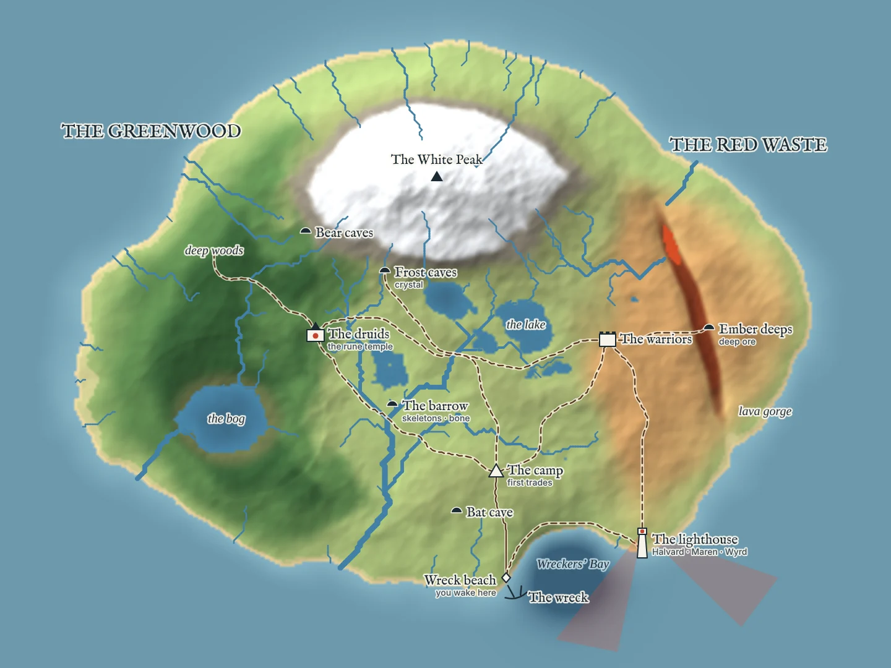

# Rune Isle

Canon for the world of Rune Isle: what is true on the island, what a player
learns and in what order, and which parts of the game each fact explains.
Terms marked *(coined)* were invented in the writing and are open to being
renamed.

## In one paragraph

A ship caught in a storm goes down off an island, and you wake on the beach
beside the wreck. Every player arrives this way. Everyone else on the island
has lived here since before Wyrd. The people here
learned to carve runes, which let them use the three elements: fire, water and
nature. The best carver who ever lived went further. At the top of his
lighthouse, the tallest thing on the island, he keeps **Wyrd**, the rune he cut
from his dead wife's heart, and it holds the island in a loop: nobody on it
dies, ages or has children, and the storms it throws off wreck every ship that
comes near. People who are killed wake up again, in pain
and missing part of what they knew. Two towns have formed around two answers
to the curse. One carves and uses runes for everything it does. The other
refuses to touch them.

## The island

The island is an ordinary island. The rats, bats, deer, wolves, trolls and
everything else living on it have always been there. What changed it is that
people learned to carve runes.

The map is a planning sketch, not the game map. It is seed 75599 of a terrain
generator: the height is shaped by the rules in this doc (the peak in the
north, the desert and its gorge in the east, the woods and the bog in the
west, the bay in the south), and the lakes and rivers come from rain flowing
downhill over it. Places and roads are put down by rules, and the names on it
are placeholders. The game builds this seed at half a cell per pixel of the
sketch, the largest island the server can hold, so the road between the two
towns by the inn is about 340 cells, a little over a minute's walk
(`docs/map.md`).

## Runes

A **rune** is a piece of material with a mark carved into it. Held and used, it
casts. Runes are what the game called arcane stones; "rune" is shorter, and the
game is named after them.

**Runes are always made, never found.** No creature drops one and none lies in
a dungeon. Every rune on the island was carved in the rune temple.

### What a rune is carved from

The material decides how strong the rune is.

| Material | Rune | Where it comes from |
| --- | --- | --- |
| **Bone** | Crude | Easy to get. Skeletons drop it, and so do many animals. |
| **Crystal** | Medium | Mined in risky places. |
| **Obsidian** | High | Rare volcanic glass found only deep in dungeons, and slow to mine. |

More materials can be added later.

### What decides its element

A rune is carved from its material together with an **essence** *(coined)* of
an element: fire essence, water essence or nature essence. Essence is a rare
drop from **every** creature, and a creature drops the essence of its own
element. Fire runes come from hunting fire creatures.

A rune carved with no essence is **neutral**: Light, Spark and the like.

**Which rune comes out is random** within its material and its element. Bone
with fire essence gives one of the crude fire runes, not a chosen one.

### The rune temple

Every rune forge is in the **rune temple**, in the druids' town. The town was
built around it. There is one forge for each material.

Making a rune takes two steps:

1. **The player shapes the material into a blank rune** at its forge: bone
   into a crude blank, crystal into a medium one, obsidian into a high one.
2. **The runemaster carves it.** The runemaster *(coined)*, an elder of the
   temple, takes the blank and an essence and carves the mark. Only the
   runemaster carves; no player can.

The runemaster is also who teaches how the forges work and which material
each one takes.

The warriors refuse runes, so a player who wants both a warrior's kit and
runes has to deal with both towns.

### How runes look

Each rune has to read as itself in an 8×8 sprite, so the mark and the colour
carry its identity: the element decides the palette, the material decides the
base, and the mark decides which rune it is.

## Wyrd

Wyrd is the one rune that is not of any of the three elements. **It stops
death and locks the island in a loop.** While it holds:

- **Nobody dies.** A person who is killed wakes up again, whole, at the place
  they have chosen to wake (see *Waking*). It hurts every time, and nobody gets
  used to it.
- **Nobody changes.** Nobody ages, nobody conceives and nobody is born. There
  are no children on the island.
- **The storms never stop.** The rune throws off weather the way a fire throws
  off heat. The storms around the island sink every ship that comes near, and
  no boat built on the island gets out.

### What dying costs

Waking up is not free. Every death takes **a part of yourself**: some of what
you had learned is gone when you wake. People who have been on the island a
long time and died often talk about this the way people elsewhere talk about
growing old. In the game this is the experience a death takes from every
mastery.

## The wizard and his lighthouse

The wizard, **Halvard**, was **the best runecarver who has ever lived**. He
lived in a lighthouse on the island with his wife, **Maren**, and she was sick
and dying.

He experimented with death and resurrection, trying to carve a new rune that
would save her. He was at that work when she died, and he missed her last
breaths. When he found her dead, he **carved her heart into a rune** and put
all of his power into it. That rune is **Wyrd**. It brought her back, and it
took death away from everyone else on the island with her.

**Maren is undead.** She came back without her heart, and she is not the person
who died. **He is still in the lighthouse**, at the top with Wyrd, trying to
find a way to save her properly. He has not stopped since.

Halvard built the lighthouse to bring ships safely into the island's harbour,
and the islanders built its lower floors for him. Its light is now Wyrd. Ships
see it in the storm and steer towards it, and that is how they are wrecked.

### Climbing the lighthouse

The lighthouse stands on the island, visible from every shore. **It is easy to
reach and very hard to climb.** It has many floors, each harder than the one
below, and the upper floors cannot be climbed alone: they need a group working
together.

- **Maren is a boss partway up.**
- **Halvard is the final boss**, at the top, with Wyrd.

## The three elemental lands

Each element has its own land on the island, and **each one starts easy at its
edge and gets harder the deeper you go**, so a new player can hunt weak
creatures of any element from the start.

- **Water**: water creatures in the shallows on the beach, their home at the
  lake, and stronger ones up the mountain, turning to ice near the snow peak.
- **Fire**: weak creatures at the edge of the desert, stronger ones in the
  open waste, and the strongest in the lava gorge.
- **Nature**: the forest edge, then the deep woods, the caves where bears
  live, and the bog.

## Islanders and castaways

- **Every character in the game is an islander.** They lived here before
  Halvard carved Wyrd. They knew him, and Maren when she was alive, and they
  remember an island where people aged, had children and died. They have been
  the same age ever since.
- **Only players are castaways.** Each one is a real person who joins the
  game, and arrives the way every player does: wrecked by Wyrd's storms and
  waking on the beach. To the islanders, castaways are the only new faces
  there have been since Wyrd.

Nobody leaves, islander or castaway.

### The island before Wyrd

**Wyrd took hold about 130 years ago.** Everyone looks the age they were that
night.

- **The island was a port.** A harbour town stood on Wreckers' Bay, below the
  lighthouse, and ships came and went. Traders and sailors from many countries
  settled there, which is why the islanders' names come from so many places.
- **The harbour town is abandoned.** After Wyrd the storms broke every ship in
  the bay and flooded the waterfront, and people moved inland. Its ruins are
  still on the bay.
- **The two towns came from a split over runes.** Those who kept carving built
  the druids' town around the rune temple; those who refused walked east and
  built the warriors' town.
- **The camp was put up to meet the castaways.** Ships still come in on the
  storm, and the only people who walk out of the wrecks are castaways.

This is the main way a player learns the lore. **Islanders speak openly about
it**, without being asked twice:

- what the island was like before Wyrd, and what they did then;
- how long it has been, as near as anyone can count;
- how many times they have died, and what killed them;
- how much it hurt. Being killed by a troll is remembered as the worst.

They are not mysterious about the curse. They have lived with it for years and
talk about it plainly, the way people talk about the weather.

### Townsfolk wake too

The curse applies to everyone, so **a townsperson who is killed wakes up
again** after a while, in the same place, and remembers being killed. They
drop **only their skull**, never their kit, so killing a shopkeeper is not a
way to get rich. No town buys a human skull: it belonged to someone they know.

## The opening

1. **The wreck.** You wake on the beach beside the remains of the ship. The
   wreck is a place you come back to: it can be salvaged.
2. **The hunter.** A local hunter finds you on the beach. She tells you there
   is a camp nearby, and teaches you that **eating heals**: being fed is what
   brings health back. She is the first person to tell you that you will not
   die here, and what it costs.
3. **The path.** A road leads up from the beach to the camp through a valley
   walled by steep hills, so the way is short and cannot be missed. Only small
   creatures live on it: rats, rabbits, deer, a couple of snakes and a cave of
   bats in the valley side.
4. **The camp.** The first place to trade, and the first people to explain the
   island. From here the player learns about the two towns.

The lighthouse is visible from the beach on the first screen. A new player does not
need anyone to tell them it matters.

### Around the camp

The first area is where a new player learns to fight, eat and trade.

- **Rats**, the first thing worth fighting.
- **Deer and rabbits**, for meat and leather.
- **A cave with bats**, the first time underground.
- **Leather** trades at the camp for a basic set of gear.
- **Traps** are made at the camp. *(The material is open; salvage from the
  wreck, such as rope and nails, would tie the beach to the first crafting.)*

## The two towns

The people at the camp tell you about two towns. Each one is about a minute's
walk from the other, and the roads between them have threats a new
player should be careful of. You can go to both, trade and talk with both, and
understand both sides. Neither of them is wrong.

Their disagreement is about Wyrd.

### The druids

A town of druids who carve runes and use them for everything: cooking, hunting
and building. To them runes are the island's three elements put to use, and
Wyrd is the same craft taken too far. The fault was the wizard's,
not the craft's.

Everything magic is here: runes, spells and whatever a caster wears.

### The warriors

A town that rejects runes completely and relies on strength and training. To
them every rune is a step towards Wyrd, and the craft that made the
curse cannot be trusted with anything. They train their bodies because a body
is the one thing no rune made.

Everything for fighting is here: weapons, armour, and gear that **resists
magic**. In the game, resisting magic is a property of what you wear, so this
town is where a player goes to stand up to the druids' spells.

## Money and work

- **Gold is the only money.** There are no shards.
- **Towns buy what the island gives:** bones, animal skulls, leather. This is
  what keeps money moving: every hunter has something to sell.
- **Dungeons are fixed.** They are designed by hand and do not change. A
  procedurally generated dungeon is a possible later feature, and the
  lighthouse is a candidate for it.

## Waking *(the respawn point)*

A new arrival wakes on the beach. A player who wants to live in a town can
choose to wake there instead, so each town (and the camp) has a place to bind
to.

## What the game no longer has

These were canon before this rewrite and are not any more:

- The Arcane, Arcania, Aether, the High Council, Realm Phase and the
  Convergence.
- Garius, Dieter and Holleg, and the stones Stasis, Genesis and Suffocate.
- The sixty-day cycle.
- The idea that the island's creatures came from somewhere else.
- The king. There is no ranking that crowns anybody.
- Arcane shards as money.
- The name "arcane stone". They are runes.
- Runes dropped by creatures, including wisps.
- Numbered lives (Maren I, Maren II). A person who dies is the same person.
- Lord Corvin and Ysolde, unless they are given a place in one of the towns.

## Open questions

- **What happens if Wyrd is broken.** People could die and age
  again, and ships could leave. The two towns would not agree on whether to do
  it.
- **What is inside the lighthouse**, floor by floor, and what makes a floor
  need a group.
- **The two towns' names**, if they get names beyond the druids and the
  warriors.
- **What traps are made from.**
- **What became of the island's children** when Wyrd stopped everyone aging.
